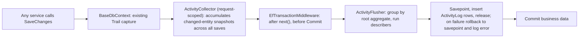

# Readable Activity Log (centralized) - SAVED FOR LATER

> [!NOTE]
> Status: **planned, not approved, no code changed.** UI mock: [activity_mock.html](activity_log_mock.html)

## Goal
Today `BaseDbContext.SaveChangesAsync` writes one raw `Trail` row per changed DB row (`TableName`, `OldValues`/`NewValues` JSON). One sale invoice yields many unrelated rows (`SaleMaster`, `Sale` lines, `SalePayment`, `GlEntry`, `ItemTransaction`). `GET personal/logs` returns them raw, and no screen uses them.

**Target:** one readable entry per user action, e.g. *"Created Sale Invoice S-1042 for Zain Traders - 3 items, total Rs 12,500, received Rs 5,000"*, shown in the global Activity page and in a History tab on forms.

## Key Decisions
1. **One central point. No logging calls in the service layer.** Services (`SaleService`, etc.) are not modified at all. Activities are derived from the change data the DbContext already captures.
2. **Hybrid describers.**
   - A generic fallback describes any entity with no describer (*"Updated Customer C-077 - phone, credit limit"*, using friendly column labels).
   - Rich describers per document (Sale, Purchase, Payment, Returns, Stock Adjustment), added module by module starting with Sales.
3. **Flush once per request, inside the request transaction**, not on every `SaveChanges` (one request can save several times, e.g. `SaleService.CreateAsync` and the recursive save in `BaseDbContext`).
4. **Failure isolation with a savepoint.** Activity failure never fails the request.
5. **Snapshot names, keep ids.** Historical text uses the values at the time. `Data` also stores ids (`customerId`, `itemId`) so names link to the live record and per-customer feeds survive renames. No live name resolution on read.
6. **Keep raw `Trail`** as the source of truth. `Trail.ActivityId` links raw rows to their activity (drill-down for admins).

## Architecture



### How the central point works
- **Capture:** inside the existing `HandleAuditingBeforeSaveChanges`, which already has entity, state, old values and new values, push a lightweight `ChangeSnapshot` (entity type, key, state, old/new values, entity reference) into the request-scoped `ActivityCollector`. It also stamps `Trail.ActivityId` from the request's activity id. No extra queries.
- **Grouping (root aggregates):** each describer declares the root and its children, so the flusher can claim snapshots without any service involvement.

```csharp
public interface IActivityDescriber
{
    Type Root { get; }                      // SaleMaster
    IReadOnlyCollection<Type> Children { get; }  // Sale, SalePayment, GlEntry, ItemTransaction
    string EntityType { get; }              // "Sale Invoice"
    string KeyOf(ChangeSnapshot s);         // VNo shared by root and children
    ActivityEntry? Describe(ActivityGroup group);  // group = root + children, net changes
}
```
- **Action** comes from the root's final state: Added → Created, Modified → Updated, soft delete → Deleted.
- **Net diff:** `SaleService.UpdateAsync` deletes and re-adds payments and GL rows. The describer works on the net change per key across the whole request (same key removed and re-added with the same values = no change), so edits don't read as "everything changed".
- **Unclaimed snapshots** (e.g. `ItemDetail` balance updates that are side effects of a claimed group) are absorbed into the group when they share the key, otherwise dropped. Unclaimed roots with no describer go to the generic fallback.
- **Intent that the DB can't know** (e.g. a delete reason) is optional and later: an `[ActivityReason]` hint set from the controller into the collector. Not in the first release.
- **Background jobs** (e.g. `DailyRecurringVouchersJob`) have no middleware, so they call the same `ActivityFlusher` at the end of the job.

## Data Model

```csharp
public class ActivityLog : BaseEntity<Guid>      // table ActivityLog
{
    public string UserId { get; set; }
    public string UserName { get; set; }          // snapshot
    public DateTime OccurredAt { get; set; }      // PakistanTime.Now
    public string Action { get; set; }            // Created | Updated | Deleted
    public string EntityType { get; set; }        // "Sale Invoice"
    public string EntityKey { get; set; }         // "S-1042"
    public string? RelatedAccountId { get; set; } // customer/vendor id for per-party feeds
    public string Summary { get; set; }           // rendered sentence (snapshot names)
    public string? Effects { get; set; }          // JSON: [{kind:"Stock",text:"..."}]; no child table
    public string? Data { get; set; }             // JSON: ids and amounts
}
```
Indexes: `(EntityType, EntityKey, OccurredAt DESC)`, `(UserId, OccurredAt DESC)`, `(RelatedAccountId, OccurredAt DESC)`. Add nullable indexed `Trail.ActivityId`.

## Failure Isolation
> [!IMPORTANT]
> Activity logging is best-effort. Business data is not. The whole request shares one transaction (`EfTransactionMiddleware`), so a failed statement on PostgreSQL would abort it. A retry is therefore not an option, and a savepoint is used instead.

1. **Describer exceptions:** caught per group. Log `LogError(ex, "Activity describe failed {EntityType} {EntityKey}")`, then store a minimal generic entry (*"Sale Invoice S-1042 updated"*). If that also fails, skip it.
2. **Insert failure:** flush inside `CreateSavepointAsync`. On exception, `RollbackToSavepointAsync`, log the full payload (`Summary`, `EntityKey`, `UserId`, `Data`) as an error so it can be recovered from logs, then commit the business data normally.
3. **Input hygiene:** strings are truncated to column length and null-safe before insert, so insert failures are very unlikely.
4. **Request failure:** the existing catch rolls everything back and the queue is discarded, so there is no activity for an action that didn't happen.
5. **Read side:** screens show an inline "Couldn't load activity" state and never block the form.

## Proposed Changes
### Application (`retailsuite-api/src/Core/Application/Auditing`)
- **[NEW]** `IActivityDescriber`, `ActivityEntry`, `ChangeSnapshot`, `ActivityGroup`, `ActivityDto`, `ActivityFilter`.
- **[MODIFY]** `IAuditService`: add `GetActivitiesAsync(ActivityFilter)` with keyset pagination on `(OccurredAt, Id)`.

### Infrastructure (`src/Infrastructure`)
- **[NEW]** `Auditing/ActivityLog.cs`, EF config, migrations for all providers.
- **[NEW]** `Auditing/ActivityCollector.cs` (scoped), `ActivityFlusher.cs`, `GenericActivityDescriber.cs`.
- **[NEW]** `Auditing/Describers/SaleInvoiceDescriber.cs` first; Purchase, Payment, Returns, Stock Adjustment later.
- **[MODIFY]** `Trail.cs` (+`ActivityId`), `AuditTrail.cs`, `BaseDbContext.HandleAuditingBeforeSaveChanges` (push snapshots; no behaviour change to existing audit).
- **[MODIFY]** `Middleware/EfTransactionMiddleware.cs`: flush before `CommitAsync`.
- **[MODIFY]** `AuditService.cs`: query `ActivityLog` with `AsNoTracking` and project to DTO.
- Services (`SaleService` etc.): **no changes.**

### API
- **[NEW]** `GET /api/activity?entityType=&entityKey=&accountId=&userId=&from=&to=&cursor=`. Permission-gated: own activity for normal users, all with the audit permission.
- **[MODIFY]** `PersonalController.GetLogsAsync` returns activities.

### Screens
- Reusable `ActivityTimeline` component: History tab on forms (entity filter) and a global Activity page (filters: user, date, document type, action, search). Both use the same endpoint.

## Efficiency Notes
- Per user action: one `ActivityLog` insert in the same transaction, with side effects stored as a JSON column and no child table.
- Reads: indexed single-table, keyset paging, sentence pre-rendered, no joins.
- Describers run once per request on data already in memory.
- **Open optimization (decision needed):** `Trail` rows for transactional child entities roughly double write volume. Options are to keep `Trail` for master data only, or to give it a short retention. Not changed in this plan.

## Open Questions
1. First release scope: Sales only, or Sales + Purchases + Payments?
2. Visibility: everyone sees all, or own only with admins seeing all?
3. Language: English only or also Urdu?
4. Back-fill old `Trail` rows into basic activities, or start from go-live?
5. `Trail` retention / master-data-only decision (above).

## Verification Plan
- Unit tests per describer (create/update/delete, net diff of delete-and-re-add, formatting).
- Integration: one sale create, update and delete each produce exactly 1 `ActivityLog`, and all linked `Trail.ActivityId` match. A request rollback leaves none. A describer that throws still lets the sale succeed. A forced insert failure still commits the sale and logs the payload (savepoint).
- `dotnet build` and `dotnet test` in `retailsuite-api`.
- Manual: edit an invoice, check the History tab and global page, test filters and paging on ~100k seeded rows.

> [!NOTE]
> Per `AGENTS.md`, nothing will be committed or pushed.
