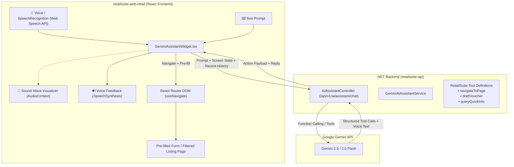

# Gemini-Style Voice & Text AI Chatbot for Navigation & Data Entry

## Goal Description
Implement an intelligent multimodal AI assistant (supporting both **voice** and **text**, styled like **Gemini Mobile**) within RetailSuite (`retailsuite-web-retail` and `retailsuite-api`, with subsequent extension to `retailsuite-mobile`).

The assistant enables users to:
1. **Navigate and filter listing pages hands-free using natural language**:
   - User says: *"Get me to payment listing from 1st of this month to today for Cash account"*
   - The AI parses intent, dates, and account details, navigates to `/daily-entries/payment-voucher?fromDate=2026-10-01&toDate=2026-10-21&cashBankAccount=...`, and loads matching data automatically.
2. **Perform conversational data entry and drafting**:
   - User says: *"Create a payment voucher for $1,200 to ABC Suppliers for packing materials"*
   - The AI constructs the voucher draft, validates fields against system lookups, navigates directly to `/daily-entries/payment-voucher/new` with pre-filled state, and allows the user to review, edit, and click Save.
3. **Gemini Mobile Experience**:
   - Floating iridescent gradient orb/pill at the bottom right.
   - Continuous listening with live Voice Activity Detection (VAD) and animated audio waveform.
   - Dual-mode: Hands-free voice conversation with Text-to-Speech (TTS) spoken replies, or standard text chat with quick suggestion chips.

---

## High-Level Architecture



---

## Costing & Sustainability Analysis

### 1. Voice Recognition & Speech Feedback (STT & TTS)
* **Cost: $0.00 (100% FREE)**
* Uses the browser’s native **Web Speech API** (`webkitSpeechRecognition` & `window.speechSynthesis`).
* Zero per-minute server audio costs, zero external voice subscription fees.

### 2. AI Intelligence (Google Gemini Flash API)
* **Google AI Studio Free Tier**: Up to 15 requests/min and 1,500 requests/day (**$0.00 / month**).
* **Pay-As-You-Go Tier (Production)**:
  * Gemini 2.5/2.0 Flash input: ~$0.075 / 1M tokens. Output: ~$0.30 / 1M tokens.
  * Average command cost: **~$0.0001 per command** (10,000 commands ≈ $1.00 USD).
  * Typical single-store operation (500 commands/day): **~$1.50 to $2.00 / month**.

### 3. Long-term Stability & Context Management
* **Future-Proofing**: Model name is stored in `appsettings.json` (`"Model": "gemini-2.5-flash"`). Upgrading to future models (e.g. Gemini 3) requires zero code changes.
* **Sliding Context Window**: Only the last 4–6 messages are retained in conversation memory, preventing token accumulation.
* **Screen State Injection**: Current page URL and active filters are sent with the request (~300 tokens), providing instant contextual awareness without re-sending long conversation histories.

---

## Detailed Implementation Components

### 1. Backend .NET AI Endpoint (`retailsuite-api`)

#### File: `src/Core/Application/Common/Interfaces/IAiAssistantService.cs`
- Contract for processing natural language prompts and returning structured navigation/draft actions.
- DTOs: `AiAssistantRequest`, `AiAssistantResponse`, `AiActionType` (`Navigate`, `DraftVoucher`, `Answer`).

#### File: `src/Infrastructure/AI/Gemini/GeminiAiAssistantService.cs`
- Communicates with Google Gemini API using function calling / structured tools:
  - `navigateTo(path, queryParams, speechSummary)`
  - `draftPaymentVoucher(partyName, amount, remarks, accountName)`
  - `draftReceiptVoucher(...)`
- Injects current server date, tenant context, and active menu permissions into system instructions.

#### File: `src/Host/WebAPI/Controllers/AI/AiAssistantController.cs`
- Controller route: `[HttpPost("api/v1/ai/assistant/chat")]` with authorization and tenant verification.

#### File: `src/Host/WebAPI/appsettings.json`
```json
"GeminiSettings": {
  "ApiKey": "YOUR_GEMINI_API_KEY",
  "Model": "gemini-2.5-flash"
}
```

---

### 2. Frontend Filter & Route Deeplinking (`retailsuite-web-retail`)

#### File: `src/pages/daily-entries/PaymentVoucherList.tsx`
- Read URL search parameters via `useSearchParams()` (`fromDate`, `toDate`, `cashBankAccount`, `voucherNo`).
- On mount, if parameters exist, populate filter fields and execute search automatically.

#### File: `src/pages/daily-entries/PaymentVoucherForm.tsx`
- Read draft state from `location.state?.draftData`.
- Pre-populate voucher amount, remarks, and accounts, with an informational alert: *"Drafted by AI Assistant — please review and save."*

---

### 3. Voice Recognition & Audio Feedback

#### File: `src/hooks/useVoiceAssistant.ts`
- Speech-to-Text via `SpeechRecognition` / `webkitSpeechRecognition`.
- Continuous listening with silence detection (auto-submit on pause).
- Audio volume visualizer using `AudioContext` and `AnalyserNode` for dynamic waveform rendering.
- Text-to-Speech via `window.speechSynthesis` with natural voice selection.

---

### 4. Gemini-Style UI Widget & Assistant Drawer

#### File: `src/components/ai/GeminiAssistantWidget.tsx`
- **Floating Gemini Orb**: Iridescent gradient button in bottom-right corner (`#4285F4`, `#9B51E0`, `#00C9FF`).
- **Hands-Free Assistant Sheet**:
  - Live sound wave visualizer when listening.
  - Real-time transcript display.
  - Suggestion chips:
    - *"Show payment listing for this month"*
    - *"Create a payment voucher for $500"*
    - *"Go to sales report"*
  - Action execution cards with spoken audio confirmation.
- Global keyboard shortcut: `Alt + A` or `Ctrl + Space`.

#### File: `src/services/aiAssistantService.ts`
- API client calling `/api/v1/ai/assistant/chat`.
- Dispatches navigation to React Router (`navigate`) and manages conversation history.

#### File: `src/layouts/MainLayout.tsx`
- Mount `<GeminiAssistantWidget />` globally so it is available across all pages.

---

## Verification Plan

1. **Voice Navigation**:
   - Speak: *"Take me to payment listing from 1st of this month to today for Cash account"*.
   - Verify speech is transcribed $\rightarrow$ assistant speaks confirmation $\rightarrow$ navigates to `/daily-entries/payment-voucher?fromDate=...&toDate=...` $\rightarrow$ table displays filtered records.
2. **Data Entry Drafting**:
   - Speak: *"Draft a payment voucher of 2500 for office supplies"*.
   - Verify assistant confirms $\rightarrow$ navigates to `/daily-entries/payment-voucher/new` $\rightarrow$ form populated for user review and saving.
3. **Follow-Up Conversation**:
   - Speak: *"Now change the date to last month"*.
   - Verify context is preserved without resetting existing account filters.
4. **Text Chat**:
   - Verify typing queries in the drawer functions identically to voice.
