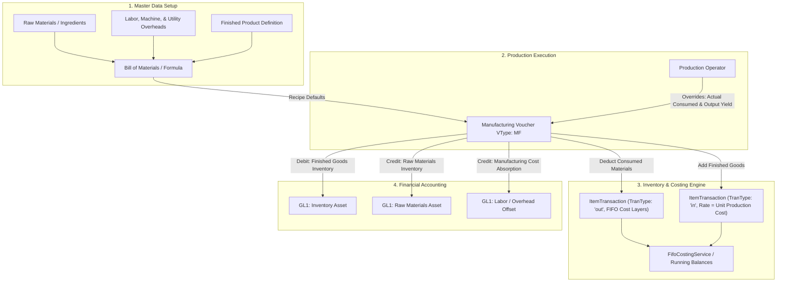

# Manufacturing & Production Feature Implementation Plan

## Goal Description
Implement an end-to-end **Manufacturing & Assembly System** across RetailSuite (`retailsuite-api`, `retailsuite-web-retail`, and `retailsuite-desktop`). 

This feature allows businesses (food & beverage, bakeries, feed/grain mills, assembly, and repackaging operations) to:
1. Define multi-level or standard **Bills of Materials (BOM) / Recipes** with ingredient quantities, wastage/scrap factors, and overhead cost allocations (labor, utility, machine hours).
2. Execute **Manufacturing / Production Vouchers** (`VType = "MF"`):
   - Automatically deduct consumed raw materials from inventory using established **FIFO cost layers**.
   - Produce finished goods with total calculated unit cost (`Raw Material FIFO Cost + Overheads`).
   - Track actual consumption vs recipe standard (variance tracking).
3. Post balanced double-entry accounting transactions to General Ledger (`GL1`).
4. Support both standard tenants and specialized manufacturing workflows (e.g. Wanda feed milling).

---

## Architecture & Data Flow



---

## Key Design Principles & Conventions

> [!IMPORTANT]
> **Voucher Type Code**: `MF` for Manufacturing / Assembly and `MD` for Disassembly / Reverse Manufacturing.
> **Costing Basis**: Finished goods unit cost is computed dynamically as:
> $$\text{Unit Cost} = \frac{\sum(\text{Actual Consumed Qty} \times \text{FIFO Cost}) + \text{Allocated Labor \& Overhead}}{\text{Actual Produced Qty}}$$
> **Feature Flagging**: A tenant setting `Manufacturing.EnableManufacturing` will control sidebar menu visibility, allowing non-manufacturing retail stores to keep their interface clean.

> [!NOTE]
> **Basic Work-In-Progress (WIP) Tracking Included**:
> - **Status Lifecycle**: `Planned` $\to$ `In Progress (WIP / Issued)` $\to$ `Completed` $\to$ (or `Cancelled`).
> - **Stage Tracking**: Simple production stages on the batch (e.g. *Material Issuance*, *Processing/Mixing*, *Packaging/Finishing*).
> - **WIP Accounting**: Materials issued move to a dedicated WIP Inventory account until the batch is marked `Completed`, at which point costs transfer into Finished Goods Inventory.
> - **Sub-Assembly / Multi-level BOM**: Finished products from one BOM can be used as raw materials in subsequent BOM stages.

---

## Proposed Changes

---

### Component 1: `retailsuite-api` (Domain, Application, Infrastructure, Host)

#### 1. Authorization Permissions
- **File**: `retailsuite-api/src/Core/Shared/Authorization/AppPermissions.cs`
- Add resources:
  - `public const string BillOfMaterials = nameof(BillOfMaterials);`
  - `public const string Manufacturing = nameof(Manufacturing);`
- Register standard permissions (`View`, `Search`, `Create`, `Update`, `Delete`, `Print`, `Export`).

---

#### 2. Domain Entities
- **[NEW]** `retailsuite-api/src/Core/Domain/Legacy/BomMaster.cs`:
  - `Code`, `Title`, `FinishedItemId`, `OutputQty`, `UnitId`, `IsActive`, `IsDefault`, `LaborCost`, `OverheadCost`, `PackagingCost`, `Notes`.
- **[NEW]** `retailsuite-api/src/Core/Domain/Legacy/BomDetail.cs`:
  - `BomMasterId`, `Seq`, `RawItemId`, `Qty`, `UnitId`, `ScrapPercentage`, `IsOptional`.
- **[NEW]** `retailsuite-api/src/Core/Domain/Legacy/ProductionMaster.cs`:
  - `VDate`, `VTime`, `VType` (`"MF"`), `VNo`, `BomMasterId`, `FinishedItemId`, `TargetQty`, `ProducedQty`, `UnitId`, `BatchNo`, `ExpiryDate`, `TotalMaterialCost`, `TotalOverheadCost`, `TotalProductionCost`, `UnitProductionCost`, `NarrationId`, `Remarks`, `Status` (`Planned`, `InProgress`, `Completed`, `Cancelled`), `CurrentStage` (e.g. *Material Issued*, *Processing*, *Packaging*), `IssuedDate`, `CompletedDate`.
- **[NEW]** `retailsuite-api/src/Core/Domain/Legacy/ProductionDetail.cs`:
  - `ProductionMasterId`, `VType`, `VNo`, `Seq`, `RawItemId`, `PlannedQty`, `ActualQty`, `UnitId`, `UnitCost`, `TotalCost`, `IsIssued`.

---

#### 3. Application DTOs & Service Contracts
- **[NEW]** `retailsuite-api/src/Core/Application/Legacy/Manufacturing/IBomService.cs`
  - `GetListAsync(BomListFilter filter, CancellationToken ct)`
  - `GetByIdAsync(int id, CancellationToken ct)`
  - `GetByFinishedItemAsync(string itemId, CancellationToken ct)`
  - `CreateAsync(BomCreateRequest request, CancellationToken ct)`
  - `UpdateAsync(int id, BomUpdateRequest request, CancellationToken ct)`
  - `DeleteAsync(int id, CancellationToken ct)`
- **[NEW]** `retailsuite-api/src/Core/Application/Legacy/Manufacturing/IManufacturingService.cs`
  - `GetListAsync(ProductionListFilter filter, CancellationToken ct)`
  - `GetDetailAsync(string voucherNo, CancellationToken ct)`
  - `CalculateEstimateAsync(ProductionEstimateRequest request, CancellationToken ct)` (provides on-the-fly stock check and estimated FIFO cost for a production target)
  - `CreateAsync(ProductionCreateRequest request, CancellationToken ct)`
  - `UpdateAsync(string voucherNo, ProductionUpdateRequest request, CancellationToken ct)`
  - `DeleteAsync(string voucherNo, CancellationToken ct)`

---

#### 4. Infrastructure Implementation
- **[NEW]** `retailsuite-api/src/Infrastructure/Legacy/Manufacturing/BomService.cs`
- **[NEW]** `retailsuite-api/src/Infrastructure/Legacy/Manufacturing/ManufacturingService.cs`
  - **Transaction Lifecycle with WIP**:
    1. **Plan Stage (`Planned`)**: Generates sequential voucher number (`maxVoucherNo + 1`, formatted `D5`). Records intended target quantity and material requirements without moving inventory.
    2. **Issuance / WIP Stage (`InProgress`)**:
       - Posts raw material outflows to `ItemTransaction` (`TranType = "out"`, `QtyOut = ActualQty`).
       - Calculates raw material FIFO costs and marks lines as `IsIssued = true`.
       - Generates GL Entry:
         - **DR**: Work-In-Progress (WIP) Inventory Account
         - **CR**: Raw Materials Inventory Account
       - Updates running balances for raw materials.
    3. **Completion Stage (`Completed`)**:
       - Posts finished goods inflow to `ItemTransaction` (`TranType = "in"`, `QtyIn = ProducedQty`, `Rate = UnitProductionCost`).
       - Generates GL Entry:
         - **DR**: Finished Goods Inventory Account
         - **CR**: Work-In-Progress (WIP) Inventory Account
         - **CR**: Direct Labor & Manufacturing Overhead Absorption Account
       - Updates running balance for the finished good and updates `CompletedDate`.
    4. **Cancellation / Rollback (`Cancelled`)**:
       - If cancelled while `InProgress`, reverses issued material outflows in `ItemTransaction` and rolls back GL entries.
- **Entity Configurations**:
  - Add fluent EF Core mappings in `Infrastructure/Persistence/Configuration/Legacy/`.
- **Migrations**:
  - Generate and apply EF Core migrations for PostgreSQL and MSSQL providers.

---

#### 5. WebAPI Controllers
- **[NEW]** `retailsuite-api/src/Host/WebAPI/Controllers/Legacy/BomsController.cs`
  - Routes: `GET /api/boms`, `GET /api/boms/{id}`, `GET /api/boms/by-item/{itemId}`, `POST /api/boms`, `PUT /api/boms/{id}`, `DELETE /api/boms/{id}`.
- **[NEW]** `retailsuite-api/src/Host/WebAPI/Controllers/Legacy/ManufacturingController.cs`
  - Routes: `GET /api/manufacturing`, `GET /api/manufacturing/{voucherNo}`, `POST /api/manufacturing/estimate`, `POST /api/manufacturing`, `PUT /api/manufacturing/{voucherNo}`, `DELETE /api/manufacturing/{voucherNo}`.

---

### Component 2: `retailsuite-web-retail` (React / TypeScript / Ant Design)

#### 1. Services & API Client
- **[NEW]** `src/services/bomService.ts`
- **[NEW]** `src/services/manufacturingService.ts`
- **[MODIFY]** `src/stores/useSettingsStore.ts`:
  - Add `MANUFACTURING_ENABLE_KEY = 'Manufacturing.EnableManufacturing'`.

#### 2. User Interface Pages
- **[NEW]** `src/pages/setup/BomList.tsx`:
  - Searchable table of finished products with recipes, output yields, and standard costs.
- **[NEW]** `src/pages/setup/BomForm.tsx`:
  - Dynamic editable grid for ingredients/components.
  - Live cost calculation based on current inventory rates.
  - Overhead addition fields (labor, power, packaging).
- **[NEW]** `src/pages/daily-entries/ManufacturingList.tsx`:
  - List of production vouchers with status badges (`Planned`, `In Progress (WIP)`, `Completed`, `Cancelled`), date filtering, produced quantities, and total costs.
- **[NEW]** `src/pages/daily-entries/ManufacturingForm.tsx`:
  - Product & BOM Selector.
  - Enter Target Quantity $\implies$ auto-populates required material quantities based on formula and scrap %.
  - Live Stock Checker: Highlights components with insufficient inventory in red/orange.
  - Actual consumption override columns.
  - Summary cards: Total Material Cost, Total Overheads, Unit Cost of Finished Good.
  - Status action buttons:
    - **Issue Materials to WIP**: Moves batch to `InProgress` and executes raw material deduction.
    - **Complete Production**: Enters actual produced quantity, calculates final unit cost, and admits finished goods to stock.
    - **One-Click Quick Batch**: Direct completion in one action for operations that do not hold intermediate WIP.
- **[NEW]** `src/pages/reports/ManufacturingReport.tsx`:
  - Production batch summary.
  - Material consumption vs standard recipe variance report.

#### 3. Routing & Navigation
- **[MODIFY]** `src/App.tsx`:
  - Register `/setup/bom`, `/setup/bom/new`, `/setup/bom/:id`, `/daily-entries/manufacturing`, `/daily-entries/manufacturing/new`, `/daily-entries/manufacturing/:voucherNo`, `/reports/manufacturing`.
- **[MODIFY]** `src/layouts/MainLayout.tsx`:
  - Add Setup menu item: `Bill of Materials / Recipe`.
  - Add Daily Entries menu item: `Manufacturing Voucher`.
  - Add Reports menu item: `Manufacturing Summary & Variance`.

---

### Component 3: `retailsuite-desktop` (.NET / Windows Forms)

#### 1. API Service Clients
- **[NEW]** `retailsuite-desktop/ERP/Services/Legacy/BomApiService.cs`
- **[NEW]** `retailsuite-desktop/ERP/Services/Legacy/ManufacturingApiService.cs`
- **[MODIFY]** `retailsuite-desktop/ERP/ERP.csproj` (register new service and form files).

#### 2. Windows Forms
- **[NEW]** `retailsuite-desktop/ERP/Forms/frmBOM.cs` (and designer/resx):
  - Form to manage and view recipes for desktop users.
- **[NEW]** `retailsuite-desktop/ERP/Forms/frmManufacturing.cs` (and designer/resx):
  - Shop-floor manufacturing entry form matching `frmNormalStockAdjustment` styling and keyboard shortcut paradigms (`Enter` navigation, grid edits).
- **[MODIFY]** `retailsuite-desktop/ERP/Forms/frmMainMenu.cs`:
  - Add `manufacturingToolStripMenuItem` and `bomToolStripMenuItem` with permission checks and click handlers.

---

## Verification Plan

### Automated Tests
1. **API Build & Migration Verification**:
   ```powershell
   dotnet build "c:\My Repos\Mutahhar758\RetailSuite\retailsuite-api\Retailer.sln"
   ```
2. **Web Build & Typecheck**:
   ```powershell
   cd "c:\My Repos\Mutahhar758\RetailSuite\retailsuite-web-retail"
   npm run build
   ```
3. **Desktop Application Build**:
   ```powershell
   msbuild "c:\My Repos\Mutahhar758\RetailSuite\retailsuite-desktop\ERP\ERP.csproj" /t:Build /p:Configuration=Debug
   ```

### Manual Verification
1. **BOM Creation**:
   - Create a BOM for "Chocolate Cake 1kg" consuming Flour (400g), Sugar (300g), Cocoa (100g), Packaging Box (1 pc) + Labor ($2.00).
   - Verify unit calculations and saving.
2. **Manufacturing Execution**:
   - Record manufacturing of 10 Chocolate Cakes.
   - Verify raw material stock decreases by exactly the consumed amounts in Stock Balance / Item Ledger.
   - Verify finished good stock increases by 10 units at calculated cost.
   - Verify `RunningQtyBalance` in `ItemTransaction` updates properly for all affected items.
3. **Accounting Audit**:
   - Inspect `GL1` entries for the voucher: ensure Dr Finished Goods == Cr Raw Materials + Cr Labor.
4. **Desktop & Web Parity**:
   - Create a voucher on Web and view/edit on Desktop, and vice versa.
