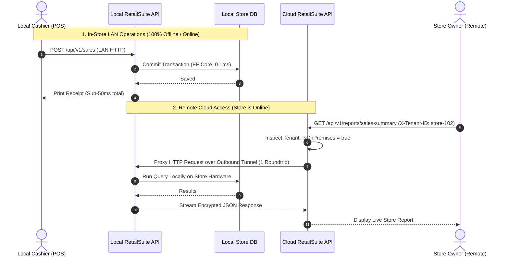
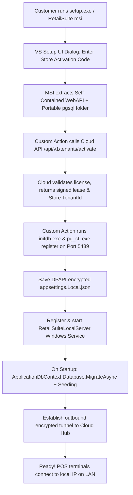

# RetailSuite Hybrid On-Premises & Cloud Architecture Plan

## 1. Executive Summary

This architecture enables RetailSuite to support **on-premises store deployments** that:
1. **Require zero code duplication:** The exact same core API, domain logic, CQRS handlers, and database entities run in both Cloud and On-Premises environments.
2. **Do not create the multi-tenant master database locally:** The local installation only creates and accesses its **own store database** (`ApplicationDbContext`). The cloud master database (`TenantDbContext` containing other tenants, billing, and global licenses) remains strictly in the cloud and is never exposed or installed locally.
3. **Work offline and online seamlessly:** Local Point of Sale (POS) terminals communicate directly over LAN with the local server with zero internet dependency. When internet is available, cloud users (HQ, mobile app, store owner) can query and control the store.
4. **Require no paid VPNs and zero firewall configuration:** Communication between Cloud and Local uses an encrypted, **outbound-only** SignalR/WebSocket tunnel built directly into `WebAPI`, requiring no public IP, no port forwarding, and no router configuration.
5. **Feature automated, secure self-installation:** A one-click installer or setup wizard initializes the local database, applies EF Core migrations, and establishes the secure channel using a one-time activation token.

---

## 2. High-Level Architecture Diagram

```mermaid
flowchart TB
    subgraph Cloud["Cloud Infrastructure (SaaS)"]
        CloudUsers["Store Owner / HQ (Web & Mobile)"]
        CloudAPI["RetailSuite Cloud API"]
        MasterDB[("Master TenantDbContext\n(All Tenants, Licenses)")]
        RelayHub["Secure Encrypted Tunnel Hub\n(WSS / SignalR / YARP)"]
        
        CloudUsers -->|HTTPS| CloudAPI
        CloudAPI -->|Tenant Management| MasterDB
        CloudAPI -->|On-Premises Requests| RelayHub
    end

    subgraph StorePremises["Store On-Premises (Customer Hardware)"]
        LANPOS["In-Store POS / Terminals"]
        LocalAPI["RetailSuite Local Server\n(Windows Service / Container)"]
        TunnelClient["Encrypted Outbound Tunnel Agent\n(No Inbound Ports Opened)"]
        LocalDB[("Local Store Database\n(ApplicationDbContext only)\nEncrypted at rest")]
        
        LANPOS -->|Local LAN (Fast & Offline)| LocalAPI
        LocalAPI --> LocalDB
        LocalAPI <--> TunnelClient
    end

    TunnelClient ==>|Encrypted Outbound TLS (Port 443)\nMutual Token / HMAC Authentication| RelayHub
```

---

## 3. Database Isolation: No Master Tenant DB on Local

In the cloud, RetailSuite uses Finbuckle to resolve tenants dynamically and connect to their databases:
- `TenantDbContext`: Contains the registry of all tenant connection strings, license dates, and features.
- `ApplicationDbContext`: Contains the actual retail data (Sales, Purchases, Inventory, Customers).

### The On-Premises Model: Dedicated Single-Store Mode & Compile-Time Stripping
On customer hardware:
- **`TenantDbContext` is physically excluded from the On-Premises build.** Using MSBuild conditional compilation (`<Compile Remove="..." Condition="'$(Configuration)' == 'OnPremises'" />` and `#if ON_PREMISES`), `TenantDbContext`, `TenantService`, `TenantDatabaseInitializer`, `TenantsController`, and all `Migrations\TenantDb\**` files are not even compiled into the On-Premises `.dll`/`.exe`. The customer never receives the master database schema, tenant management endpoints, or multitenant catalog in the binary.
- `ApplicationDbContext` runs in **Fixed Single-Store Mode**.
- When the local server boots, it uses its locally stored, encrypted connection string directly, bypassing tenant lookup headers.
- Multi-tenant query filters (`IsMultiTenant`) are automatically bound to the store's assigned `TenantId` so EF Core logic remains identical to cloud execution.

---

## 4. Free, Super-Secure Connectivity (Built-in SignalR Relay Tunnel)

To enable cloud access to the local server without paying for VPNs or forcing customers to open router ports, we use a **Built-in Application Relay (SignalR over TLS/WebSockets)** directly inside `WebAPI`.

* **Zero 3rd-party dependencies, 100% our own code.**
* **How it works:**
  1. The local server boots and `LocalTunnelAgent` (`BackgroundService`) initiates an outbound WebSocket/TLS connection to `wss://api.retailcloud.com/tunnel-hub`.
  2. The connection is authenticated using a **Hardware-Bound HMAC Signature + Store API Key**.
  3. Because the connection is outbound on standard port `443`, firewalls, NATs, and dynamic IPs allow it with zero configuration.
  4. When an API call for this tenant arrives at the Cloud API (e.g. `GET /api/v1/sales/summary`), the Cloud API dispatches the request over the existing WebSocket stream to the local server.
  5. The local server executes the request against its local PostgreSQL database and streams the response back to the cloud.

### Automatic Reconnection & Drop Recovery (24/7 Resilience)
In real retail stores, Wi-Fi routers reboot, ISPs drop connections, or the Cloud API may redeploy. The `LocalTunnelAgent` uses a **3-Layer Reconnection Strategy** so it never stays disconnected:

1. **Layer 1: Built-in SignalR Infinite `IRetryPolicy` (`.WithAutomaticReconnect`)**
   - Configured with a custom `InfiniteRetryPolicy` (`0s`, `2s`, `5s`, `10s`, and then every `30s` forever).
   - If the internet drops for 5 minutes or 10 hours, SignalR automatically retries in the background and re-registers the store in the Cloud Hub the exact second internet returns.
2. **Layer 2: Outer `BackgroundService` Watchdog Loop**
   - Handles initial boot when the store PC turns on before the store's internet router is ready, or if `Closed` fires after a token refresh.
   - Ensures the connection loop runs continuously for the lifetime of the Windows Service (`while (!stoppingToken.IsCancellationRequested)`).
3. **Layer 3: Ping/Keep-Alive Dead-Socket Detection**
   - `KeepAliveInterval = 15s` and `ServerTimeout = 30s` detect "half-open" zombie connections (e.g., someone unplugged the fiber cable from the ISP modem) within 30 seconds and immediately trigger the reconnection loop.

---

## 5. Cloud Access Routing: API Tunneling vs. Database Tunneling

When a request arrives at the Cloud API for an on-premises tenant:

```
❌ AVOID: Direct Database Tunneling
   Cloud API  ═══════════ (Tunnel) ═══════════► Local Database
   • Highly chatty: An endpoint making 10-20 EF Core queries causes 10-20 WAN roundtrips (500ms+ latency).
   • Unstable: Network packet drops mid-transaction leave hanging database locks.
   • Security risk: Exposes raw database port (1433 / 5432) to network routing.

✅ ADOPTED: Cloud-to-Local API Reverse Proxy via Outbound Tunnel
   Cloud API  ═══════════ (Tunnel) ═══════════► Local API ──► Local DB (0.1ms LAN)
   • Cloud acts as a reverse proxy router.
   • Cloud forwards the incoming HTTP request (URL, headers, body) to the Local API in a SINGLE roundtrip.
   • Local API executes all CQRS handlers, EF Core joins, and transactions LOCALLY.
   • Local API streams back only the final JSON payload.
   • Result: Sub-50ms cloud latency, zero database port exposure, consistent execution.
```

---

## 6. Offline & Online Operation Strategy



---

## 7. Subscription Expiration, Deactivation & Offline Window Calculation

To guarantee that an on-premises tenant **cannot bypass expiration or deactivation by unplugging their internet cable or changing their Windows date**:

### A. Cryptographically Signed License Lease
* Cloud issues an encrypted lease signed with the Cloud's **RSA Private Key**.
* Local API verifies the signature using the bundled Cloud Public Key.
* Modifying dates or tenant IDs in local config corrupts the RSA signature, triggering an instant startup failure.

### B. Instant Deactivation (When Online)
* While online, the local server sends a background heartbeat every 1–6 hours (`POST /api/v1/license/ping`).
* The moment a tenant is marked `IsActive = false` or expires in Cloud Admin:
  1. Next heartbeat returns `{ "IsActive": false, "Status": "Suspended" }`.
  2. Local server revokes the local lease immediately.
  3. All local API endpoints return `403 Forbidden` (`"Subscription deactivated by administrator"`).

### C. The 3-Layer Offline Window Calculation (Cannot be cheated)
When a customer unplugs the internet cable, system time alone is untrusted. The system enforces a **3-Layer Monotonic & Hardware Calculation**:

| Layer | Mechanism | Protection |
| :--- | :--- | :--- |
| **1. Hardware Tick Counter** | Reads `Environment.TickCount64` (CPU hardware crystal milliseconds since OS boot). Accumulates running seconds to a protected store. | **Immune to Windows Date/Time settings.** Changing Windows clock does not alter CPU hardware ticks. Exceeding 72 operating hours without cloud heartbeat locks the server. |
| **2. Monotonic "High-Water Mark"** | Database tracks `LastKnownUtc` timestamp, updated on every sale, audit log, and loop. Enforces **time can only move forward**. | **Clock Rollback Trap:** If system clock is set backwards (`DateTime.UtcNow < LastKnownUtc` or earlier than last sale), the system detects tampering and **locks immediately**. |
| **3. Cloud-Issued Lease Expiry** | The lease contains a strict expiration boundary: `LeaseExpiresUtc = LastCloudSyncUtc + MaxOfflineWindow` (e.g. 3 days). | `effectiveTime = Max(DateTime.UtcNow, LastKnownUtc)`. If `effectiveTime > LeaseExpiresUtc`, the offline grace period ends and POS write operations are blocked. |

### D. Enforcement Behavior (Locking Modes)
* **Soft Lock (Graceful):** Cashiers can finish open shifts and view historic sales/reports, but `CreateSale` and `CreatePurchase` operations are rejected with a renewal prompt.
* **Hard Lock:** All local API requests return `403 Forbidden`, blocking cashier login until internet is restored and the license lease renewed.

---

## 8. Super-Secure Local Protection

| Threat Vector | Mitigation Strategy |
| :--- | :--- |
| **Tampering with Local Database** | PostgreSQL runs with a system-generated, 64-character random password bound strictly to `127.0.0.1`. The connection string is encrypted using **Windows Data Protection API (DPAPI)**, accessible only by the local Windows Service account. |
| **Eavesdropping on LAN Traffic** | Local API generates a self-signed HTTPS certificate during installation or uses mTLS for in-store POS terminals. |
| **Inbound Attack / Port Scanners** | The local server **listens only on LAN** (`192.168.x.x` or `127.0.0.1`). No public ports are forwarded on the store router. All external traffic is outbound. |
| **Unauthorized Cloud Ingestion** | The tunnel handshake requires mutual authentication: Tenant ID + Hardware Fingerprint (CPU/Motherboard UUID) + Cryptographic License Key. |
| **Code Inspection & Cloud Schema Exposure** | Published as a **Compressed Single-File ReadyToRun (`R2R`) executable** (`DebugType=none`), with `TenantDbContext` and Cloud-only classes physically stripped at compile time (`<Compile Remove>`). *(Optional Control-Flow Obfuscation & Anti-Tamper is parked for a later phase.)* |

---

## 9. Automated Self-Installation Process (Visual Studio Setup Project + Portable PostgreSQL)

The installer is built using the official **Microsoft Visual Studio Setup Project (`RetailSuite.Setup.vdproj`)** producing `setup.exe` + `RetailSuite.msi`, bundling a **Portable Embedded PostgreSQL (`pgsql` binary distribution)** with `pgvector` pre-installed.

When the customer downloads and runs `setup.exe`:



### Portable Embedded PostgreSQL Strategy (Option A — Selected)
Instead of running a separate 350 MB third-party PostgreSQL installer, the `.vdproj` packages a stripped, portable **PostgreSQL 16+ Windows Binary (`pgsql\`)** (~50 MB) inside the Application Folder:
1. **Pre-bundled `pgvector` Extension:** `vector.dll` and `vector.control` are included directly inside `pgsql\lib` and `pgsql\share\extension`, guaranteeing 100% compatibility with `Migrators.PostgreSQL` (`e.UseVector()`).
2. **Zero Port or Service Conflicts:**
   - Bound strictly to `127.0.0.1` on dedicated port **`5439`** (never conflicts with a default `5432` installation and is invisible to external network scanners).
   - Registered as an isolated Windows Service (`RetailSuitePostgres`) pointing to `C:\ProgramData\RetailSuite\pgdata`.
3. **Silent Provisioning via `.vdproj` Custom Action:**
   - **Initialize cluster:** `pgsql\bin\initdb.exe -D "C:\ProgramData\RetailSuite\pgdata" -U retailsuite --pwfile="<temp_64char_pw>" -E UTF8 -A scram-sha-256`
   - **Register & start DB service:** `pgsql\bin\pg_ctl.exe register -N "RetailSuitePostgres" -D "C:\ProgramData\RetailSuite\pgdata"`
4. **Single Control Panel Entry & Clean Uninstall:**
   - Windows *Add/Remove Programs* shows only **"RetailSuite Server"** (staff cannot accidentally uninstall PostgreSQL separately).
   - Uninstalling `RetailSuite.msi` automatically stops and removes both `RetailSuiteLocalServer` and `RetailSuitePostgres` services cleanly.

---

## 10. Zero Code Duplication Implementation Plan

To keep 100% of the domain and application logic shared, the codebase is configured via runtime hosting flags:

### 1. Project Structure Sharing
```
RetailSuite/
├── src/Core/Domain/                  # 100% Reused (Entities, Aggregates, Events)
├── src/Core/Application/             # 100% Reused (CQRS Commands, Queries, Validations)
├── src/Infrastructure/
│   ├── Multitenancy/
│   │   ├── TenantDbContext.cs        # Used ONLY in Cloud Mode
│   │   ├── SingleTenantContext.cs    # Used in On-Premises Mode (resolves local store context)
│   ├── Persistence/
│   │   ├── Context/
│   │   │   └── ApplicationDbContext.cs # 100% Reused (Entity mapping & migrations)
│   │   └── Startup.cs                # Switches between Dynamic Finbuckle DB or Local PostgreSQL DB
│   └── Tunnel/
│       ├── CloudRelayHub.cs          # Cloud server: receives tunnel connections
│       └── LocalTunnelAgent.cs       # Local server: connects outbound to CloudRelayHub
├── src/Host/WebAPI/                  # Single executable with `HostingMode` switch + `.UseWindowsService()`
└── setup/RetailSuite.Setup/          # Visual Studio Setup Project (.vdproj) bundling WebAPI + portable pgsql/
```

### 2. Compile-Time Stripping of Cloud/Master DB Code (`OnPremises` Build Configuration)
To ensure `TenantDbContext` and multi-tenant management code do not even exist inside the compiled On-Premises binary:
- **`Infrastructure.csproj`, `Migrators.PostgreSQL.csproj`, and `WebAPI.csproj`:**
  ```xml
  <ItemGroup Condition="'$(Configuration)' == 'OnPremises'">
    <DefineConstants>$(DefineConstants);ON_PREMISES</DefineConstants>
    <Compile Remove="Multitenancy\TenantDbContext.cs" />
    <Compile Remove="Multitenancy\TenantService.cs" />
    <Compile Remove="Multitenancy\TenantDatabaseInitializer.cs" />
  </ItemGroup>
  ```
  *(Similarly excluding `Migrations\TenantDb\**` in `Migrators.PostgreSQL.csproj` and `TenantsController.cs` in `WebAPI.csproj`.)*
- **`Multitenancy/Startup.cs`:**
  ```csharp
  #if ON_PREMISES
      // Register static single-store tenant from local config (WithInMemoryStore + WithStaticStrategy)
  #else
      // Register TenantDbContext, TenantService, and EFCoreStore
  #endif
  ```

### 3. Configuration Profiles
- **Cloud (`appsettings.Production.json`):**
  ```json
  {
    "HostingMode": "Cloud",
    "MultitenancySettings": {
      "DefaultConnectionString": "Host=cloud-db;Database=MasterTenantDb;Username=postgres;Password=..."
    }
  }
  ```
- **On-Premises (`appsettings.Local.json`):**
  ```json
  {
    "HostingMode": "OnPremises",
    "StoreSettings": {
      "TenantId": "store-102",
      "StoreName": "Downtown Branch",
      "CloudRelayUrl": "https://api.retailsuite.cloud/tunnel"
    },
    "DatabaseSettings": {
      "DBProvider": "postgresql",
      "ConnectionString": "Host=127.0.0.1;Port=5439;Database=RetailSuite_Local;Username=retailsuite;Password=..."
    }
  }
  ```

---

## 11. Implementation Milestones

1. **Phase 1: Single-Tenant Bootstrapper & Compile-Time Stripping (`OnPremises` Build)**
   - Add the `OnPremises` MSBuild configuration (`ON_PREMISES` symbol + `<Compile Remove>` for `TenantDbContext`, `TenantService`, `TenantsController`, and `Migrations\TenantDb\**`).
   - In `Multitenancy/Startup.cs`, use `#if ON_PREMISES` to initialize `ApplicationDbContext` with the single local PostgreSQL connection string and fixed tenant ID via Finbuckle's `WithInMemoryStore` + `WithStaticStrategy`.
2. **Phase 2: Automated Local Migration & Provisioning**
   - Implement automated migration execution on startup (`dbContext.Database.MigrateAsync()`) using `Migrators.PostgreSQL` when running locally.
3. **Phase 3: Outbound Encrypted Tunnel (SignalR / gRPC Stream)**
   - Create `CloudTunnelHub` in Cloud API and `LocalTunnelAgent` in On-Premises mode.
   - Forward HTTP requests with header preservation between Cloud and On-Premises.
4. **Phase 4: Customer Installer Package (Visual Studio Setup Project + Portable PostgreSQL)**
   - Add a **Microsoft Visual Studio Setup Project (`RetailSuite.Setup.vdproj`)** directly into `RetailSuite.sln` to produce a standard Windows Installer (`setup.exe` bootstrapper + `RetailSuite.msi`).
   - Bundle the stripped **Portable Embedded PostgreSQL (`pgsql\`)** binaries (including `pgvector`) inside the `.vdproj` Application Folder.
   - Use VS Setup **User Interface Dialogs** and **Custom Actions** to capture the Store Activation Key, silently initialize the local PostgreSQL cluster (`initdb.exe` + `pg_ctl.exe register` on port `5439`), DPAPI-encrypt `appsettings.Local.json`, and register/start the `RetailSuiteLocalServer` Windows Service.
