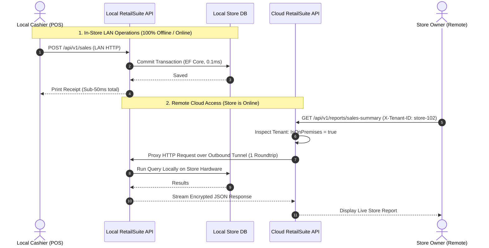
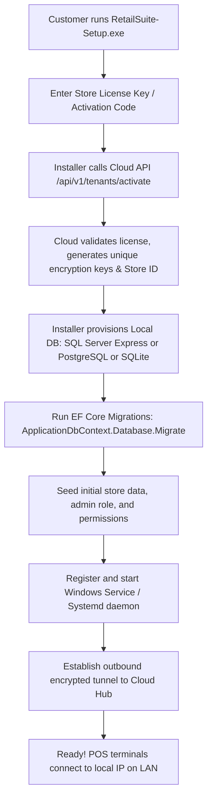

# RetailSuite Hybrid On-Premises & Cloud Architecture Plan

## 1. Executive Summary

This architecture enables RetailSuite to support **on-premises store deployments** that:
1. **Require zero code duplication:** The exact same core API, domain logic, CQRS handlers, and database entities run in both Cloud and On-Premises environments.
2. **Do not create the multi-tenant master database locally:** The local installation only creates and accesses its **own store database** (`ApplicationDbContext`). The cloud master database (`TenantDbContext` containing other tenants, billing, and global licenses) remains strictly in the cloud and is never exposed or installed locally.
3. **Work offline and online seamlessly:** Local Point of Sale (POS) terminals communicate directly over LAN with the local server with zero internet dependency. When internet is available, cloud users (HQ, mobile app, store owner) can query and control the store.
4. **Require no paid VPNs and zero firewall configuration:** Communication between Cloud and Local uses an encrypted, **outbound-only** tunnel (built into the application via WebSockets/SignalR or via free Cloudflare Tunnels), requiring no public IP, no port forwarding, and no router configuration.
5. **Feature automated, secure self-installation:** A one-click installer or setup wizard initializes the local database, applies EF Core migrations, and establishes the secure channel using a one-time activation token.

---

## 2. High-Level Architecture Diagram

```mermaid
flowchart TB
    subgraph Cloud["Cloud Infrastructure (SaaS)"]
        CloudUsers["Store Owner / HQ (Web & Mobile)"]
        CloudAPI["RetailSuite Cloud API"]
        MasterDB[("Master TenantDbContext\n(All Tenants, Licenses)")]
        RelayHub["Secure Encrypted Tunnel Hub\n(WSS / SignalR / YARP)"]
        
        CloudUsers -->|HTTPS| CloudAPI
        CloudAPI -->|Tenant Management| MasterDB
        CloudAPI -->|On-Premises Requests| RelayHub
    end

    subgraph StorePremises["Store On-Premises (Customer Hardware)"]
        LANPOS["In-Store POS / Terminals"]
        LocalAPI["RetailSuite Local Server\n(Windows Service / Container)"]
        TunnelClient["Encrypted Outbound Tunnel Agent\n(No Inbound Ports Opened)"]
        LocalDB[("Local Store Database\n(ApplicationDbContext only)\nEncrypted at rest")]
        
        LANPOS -->|Local LAN (Fast & Offline)| LocalAPI
        LocalAPI --> LocalDB
        LocalAPI <--> TunnelClient
    end

    TunnelClient ==>|Encrypted Outbound TLS (Port 443)\nMutual Token / HMAC Authentication| RelayHub
```

---

## 3. Database Isolation: No Master Tenant DB on Local

In the cloud, RetailSuite uses Finbuckle to resolve tenants dynamically and connect to their databases:
- `TenantDbContext`: Contains the registry of all tenant connection strings, license dates, and features.
- `ApplicationDbContext`: Contains the actual retail data (Sales, Purchases, Inventory, Customers).

### The On-Premises Model: Dedicated Single-Store Mode
On customer hardware:
- **`TenantDbContext` is completely omitted.** The customer never receives the master database schema, connection strings of other tenants, or multitenant catalog.
- `ApplicationDbContext` runs in **Fixed Single-Store Mode**.
- When the local server boots, it uses its locally stored, encrypted connection string directly, bypassing tenant lookup headers.
- Multi-tenant query filters (`IsMultiTenant`) are automatically bound to the store's assigned `TenantId` so EF Core logic remains identical to cloud execution.

---

## 4. Free, Super-Secure Connectivity (No Paid VPN)

To enable cloud access to the local server without paying for VPNs or forcing customers to open router ports, we use an **Outbound-Only Encrypted Tunnel**.

### Option A: Built-in Application Relay (SignalR / gRPC Streaming over TLS) — *Recommended*
* **Zero 3rd-party dependencies, 100% our own code.**
* **How it works:**
  1. The local server boots and initiates an outbound WebSocket/TLS connection to `wss://api.retailcloud.com/tunnel-hub`.
  2. The connection is authenticated using a **Hardware-Bound HMAC Signature + Store API Key**.
  3. Because the connection is outbound on standard port `443`, firewalls, NATs, and dynamic IPs allow it with zero configuration.
  4. When an API call for this tenant arrives at the Cloud API (e.g. `GET /api/v1/sales/summary`), the Cloud API dispatches the request over the existing WebSocket stream to the local server.
  5. The local server executes the request against its local database and streams the response back to the cloud.

### Option B: Cloudflare Tunnel (`cloudflared`) — *Zero Cost Infrastructure*
* **100% Free** under Cloudflare's standard plan.
* Bundled with the local installer as a background daemon.
* Establishes 4 outbound encrypted QUIC/HTTP2 tunnels to Cloudflare edge nodes.
* Gives the store a private origin hostname (e.g., `store-102.internal.retailsuite.cloud`) accessible only by your Cloud API via Cloudflare Service Tokens.

---

## 5. Cloud Access Routing: API Tunneling vs. Database Tunneling

When a request arrives at the Cloud API for an on-premises tenant:

```
❌ AVOID: Direct Database Tunneling
   Cloud API  ═══════════ (Tunnel) ═══════════► Local Database
   • Highly chatty: An endpoint making 10-20 EF Core queries causes 10-20 WAN roundtrips (500ms+ latency).
   • Unstable: Network packet drops mid-transaction leave hanging database locks.
   • Security risk: Exposes raw database port (1433 / 5432) to network routing.

✅ ADOPTED: Cloud-to-Local API Reverse Proxy via Outbound Tunnel
   Cloud API  ═══════════ (Tunnel) ═══════════► Local API ──► Local DB (0.1ms LAN)
   • Cloud acts as a reverse proxy router.
   • Cloud forwards the incoming HTTP request (URL, headers, body) to the Local API in a SINGLE roundtrip.
   • Local API executes all CQRS handlers, EF Core joins, and transactions LOCALLY.
   • Local API streams back only the final JSON payload.
   • Result: Sub-50ms cloud latency, zero database port exposure, consistent execution.
```

---

## 6. Offline & Online Operation Strategy



---

## 7. Subscription Expiration, Deactivation & Offline Window Calculation

To guarantee that an on-premises tenant **cannot bypass expiration or deactivation by unplugging their internet cable or changing their Windows date**:

### A. Cryptographically Signed License Lease
* Cloud issues an encrypted lease signed with the Cloud's **RSA Private Key**.
* Local API verifies the signature using the bundled Cloud Public Key.
* Modifying dates or tenant IDs in local config corrupts the RSA signature, triggering an instant startup failure.

### B. Instant Deactivation (When Online)
* While online, the local server sends a background heartbeat every 1–6 hours (`POST /api/v1/license/ping`).
* The moment a tenant is marked `IsActive = false` or expires in Cloud Admin:
  1. Next heartbeat returns `{ "IsActive": false, "Status": "Suspended" }`.
  2. Local server revokes the local lease immediately.
  3. All local API endpoints return `403 Forbidden` (`"Subscription deactivated by administrator"`).

### C. The 3-Layer Offline Window Calculation (Cannot be cheated)
When a customer unplugs the internet cable, system time alone is untrusted. The system enforces a **3-Layer Monotonic & Hardware Calculation**:

| Layer | Mechanism | Protection |
| :--- | :--- | :--- |
| **1. Hardware Tick Counter** | Reads `Environment.TickCount64` (CPU hardware crystal milliseconds since OS boot). Accumulates running seconds to a protected store. | **Immune to Windows Date/Time settings.** Changing Windows clock does not alter CPU hardware ticks. Exceeding 72 operating hours without cloud heartbeat locks the server. |
| **2. Monotonic "High-Water Mark"** | Database tracks `LastKnownUtc` timestamp, updated on every sale, audit log, and loop. Enforces **time can only move forward**. | **Clock Rollback Trap:** If system clock is set backwards (`DateTime.UtcNow < LastKnownUtc` or earlier than last sale), the system detects tampering and **locks immediately**. |
| **3. Cloud-Issued Lease Expiry** | The lease contains a strict expiration boundary: `LeaseExpiresUtc = LastCloudSyncUtc + MaxOfflineWindow` (e.g. 3 days). | `effectiveTime = Max(DateTime.UtcNow, LastKnownUtc)`. If `effectiveTime > LeaseExpiresUtc`, the offline grace period ends and POS write operations are blocked. |

### D. Enforcement Behavior (Locking Modes)
* **Soft Lock (Graceful):** Cashiers can finish open shifts and view historic sales/reports, but `CreateSale` and `CreatePurchase` operations are rejected with a renewal prompt.
* **Hard Lock:** All local API requests return `403 Forbidden`, blocking cashier login until internet is restored and the license lease renewed.

---

## 8. Super-Secure Local Protection

| Threat Vector | Mitigation Strategy |
| :--- | :--- |
| **Tampering with Local Database** | SQL Server / PostgreSQL runs with a system-generated, 64-character random password. The connection string is encrypted using **Windows Data Protection API (DPAPI)** or Linux MachineKey, accessible only by the service account. |
| **Eavesdropping on LAN Traffic** | Local API generates a self-signed HTTPS certificate during installation or uses mTLS for in-store POS terminals. |
| **Inbound Attack / Port Scanners** | The local server **listens only on LAN** (`192.168.x.x` or `127.0.0.1`). No public ports are forwarded on the store router. All external traffic is outbound. |
| **Unauthorized Cloud Ingestion** | The tunnel handshake requires mutual authentication: Tenant ID + Hardware Fingerprint (CPU/Motherboard UUID) + Cryptographic License Key. |
| **Code / Intellectual Property Inspection** | Local API is published with Ahead-Of-Time (AOT) compilation or obfuscated single-file binary, running as a protected Windows Service. |

---

## 9. Automated Self-Installation Process

When the customer downloads and runs `RetailSuite-Setup.exe`:



---

## 10. Zero Code Duplication Implementation Plan

To keep 100% of the domain and application logic shared, the codebase is configured via runtime hosting flags:

### 1. Project Structure Sharing
```
RetailSuite/
├── src/Core/Domain/                  # 100% Reused (Entities, Aggregates, Events)
├── src/Core/Application/             # 100% Reused (CQRS Commands, Queries, Validations)
├── src/Infrastructure/
│   ├── Multitenancy/
│   │   ├── TenantDbContext.cs        # Used ONLY in Cloud Mode
│   │   ├── SingleTenantContext.cs    # Used in On-Premises Mode (resolves local store context)
│   ├── Persistence/
│   │   ├── Context/
│   │   │   └── ApplicationDbContext.cs # 100% Reused (Entity mapping & migrations)
│   │   └── Startup.cs                # Switches between Dynamic Finbuckle DB or Local DB
│   └── Tunnel/
│       ├── CloudRelayHub.cs          # Cloud server: receives tunnel connections
│       └── LocalTunnelAgent.cs       # Local server: connects outbound to CloudRelayHub
└── src/Host/                         # Single executable with `HostingEnvironment` switch
```

### 2. Configuration Profiles
- **Cloud (`appsettings.Production.json`):**
  ```json
  {
    "HostingMode": "Cloud",
    "MultitenancySettings": {
      "DefaultConnectionString": "Server=cloud-db;Database=MasterTenantDb;..."
    }
  }
  ```
- **On-Premises (`appsettings.Local.json`):**
  ```json
  {
    "HostingMode": "OnPremises",
    "StoreSettings": {
      "TenantId": "store-102",
      "StoreName": "Downtown Branch",
      "CloudRelayUrl": "https://api.retailsuite.cloud/tunnel"
    },
    "DatabaseSettings": {
      "DBProvider": "mssql",
      "ConnectionString": "Server=localhost;Database=RetailSuite_Local;..."
    }
  }
  ```

---

## 11. Implementation Milestones

1. **Phase 1: Single-Tenant Bootstrapper Mode**
   - Add a configuration switch (`HostingMode: "OnPremises"`) in `Startup.cs`.
   - When set, bypass `TenantDbContext` and initialize `ApplicationDbContext` with the single local connection string and fixed tenant ID.
2. **Phase 2: Automated Local Migration & Provisioning**
   - Implement automated migration execution on startup (`dbContext.Database.MigrateAsync()`) when running locally.
3. **Phase 3: Outbound Encrypted Tunnel (SignalR / gRPC Stream)**
   - Create `CloudTunnelHub` in Cloud API and `LocalTunnelAgent` in On-Premises mode.
   - Forward HTTP requests with header preservation between Cloud and On-Premises.
4. **Phase 4: Customer Installer Package**
   - Package the local build into an automated installer (Inno Setup / WiX) that provisions the database and registers the background service automatically.
